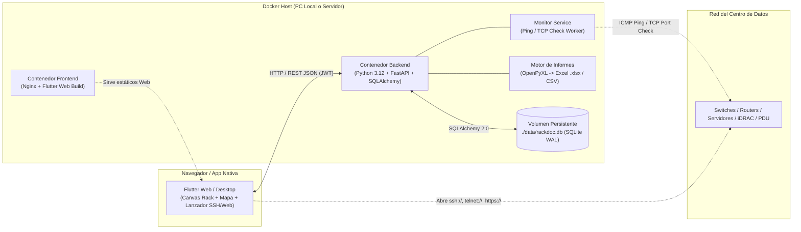

# RackDoc — Arquitectura y Plan de Implementación

**RackDoc** es una plataforma visual de gestión, monitorización y documentación de centros de datos (DCIM) inspirada en herramientas modernas como PATCHBOX, diseñada para ejecutarse mediante **Docker** tanto en un equipo local como en un servidor multiusuario.

---

## 1. Arquitectura del Sistema y Contenedores Docker

El sistema se divide en dos servicios orquestados con `docker-compose.yml` (con opción de empaquetarse en un único contenedor para despliegues ultraligeros):



> [!TIP]
> **Escalabilidad SQL sin fricción:** Configuraremos SQLite en modo `WAL` (*Write-Ahead Logging*), lo que permite lecturas y escrituras concurrentes del monitor de pings y de varios técnicos trabajando a la vez. Gracias a **SQLAlchemy**, si en el futuro se desea migrar a **PostgreSQL**, bastará con cambiar la variable de entorno `DATABASE_URL` en el `docker-compose.yml` sin tocar el código.

---

## 2. Capacidades Clave del Sistema

### 2.1. Jerarquía Completa del Datacenter (con Pasillos de Racks)
La organización física sigue la estructura real de un CPD:
`Sede (Location) ➔ Planta (Floor) ➔ Sala Técnica (Room) ➔ Pasillo / Fila (Aisle: Pasillo Frío / Caliente) ➔ Rack (Front & Back)`.

### 2.2. Caras `Front` y `Back` en Racks, Dispositivos y Cables
1. **Montaje en `front`, `back` y `full_depth`:**
   - **Poca profundidad (`is_full_depth = false`):** Ej. un Switch en el `front` (U37) permite montar en esa misma U37 por detrás (`back`) una regleta PDU o pasacables trasero sin colisión.
   - **Profundidad completa (`is_full_depth = true`):** Ej. un Servidor 2U o un SAI (UPS) ocupa las unidades U tanto en el frontal como en la trasera.
2. **Puertos por Cara (`face: 'front' | 'back'`):**
   - Cada plantilla define qué puertos van delante y cuáles detrás (ej. servidor con bahías en `front` y fuentes C14 + puertos IPMI/RJ45/SFP+ en `back`; patch panel con bocas RJ45 en `front` y regletas punch-down en `back`).
3. **Trazado de Cableado (`Front ↔ Front`, `Back ↔ Back`, `Front ↔ Back` y `Outbound`):**
   - Trazado ortogonal automático por las canaletas laterales izquierda y derecha.
   - Indicadores **`PASS-THROUGH (FRONT/BACK)`** cuando un cable cruza de la cara delantera a la trasera del mismo rack.
   - Indicador **`OUTBOUND`** cuando el cable viaja a otro rack del mismo pasillo o sala.

### 2.3. Gestión de Red, Acceso Remoto (SSH / Telnet / Web) y Variables Personalizadas
Cada dispositivo montado en el rack almacena su configuración de red e inventario completo:
- **Red:** `Hostname`, `FQDN` (ej. `sw-core-01.cpd1.empresa.local`), `IP Address`, `Subnet Mask` (ej. `255.255.255.0` / `/24`), `Gateway`, `VLAN de Gestión`, `MAC Address` e `IP IPMI/iLO/iDRAC`.
- **Lanzador de Conexión Directa:** Configurables por dispositivo (`SSH`, `Telnet`, `HTTPS/Web UI`, `HTTP`, `SNMP`, `RDP`) con su puerto específico:
  - Desde el panel derecho del dispositivo en Flutter tendrás botones de **1 clic (`Abrir SSH`, `Abrir Web UI`, `Abrir Telnet`, `Abrir iDRAC`)** que disparan el protocolo nativo (`ssh://usuario@ip:puerto`, `telnet://ip:puerto`, `https://ip:puerto`) o copian el comando listo para terminal.
- **Variables Extensibles (`custom_fields` JSON):** Permite añadir cualquier variable adicional (contrato de mantenimiento, versión de firmware, consumo en vatios, credenciales de referencia, etc.) sin limitaciones de esquema.

### 2.4. Monitorización de Estado (Ping / Check de Puertos)
- El contenedor Backend incluye una tarea programable (y botón de **"Test Ping Ahora"** en la interfaz) que comprueba desde el servidor si el equipo responde por **ICMP Ping** o **TCP (puerto 22/80/443)**.
- Registra el estado (`online`, `offline`, `warning`, `unmonitored`), la **latencia en milisegundos (`last_ping_ms`)** y la fecha del último chequeo.
- En el dibujo del rack, cada dispositivo muestra un **LED indicador de estado en vivo** (verde si responde al ping, rojo si está caído, gris si no se monitoriza).

### 2.5. Generación y Exportación de Informes Excel (`.xlsx`) y CSV
El backend genera informes descargables en formato **Excel (`.xlsx` multicapa con estilos)** y **CSV**, filtrables por Sede, Planta, Sala, Pasillo o Rack:
1. **Hoja 1 - Ubicaciones y Racks:** Sede, Planta, Sala, Pasillo, Código de Rack, Unidades U totales/ocupadas/libres, Responsable.
2. **Hoja 2 - Inventario de Hardware y Red:** Ubicación, Rack, Unidad U, Cara (`Front`/`Back`), Nombre, FQDN, IP, Máscara, Gateway, Fabricante, Modelo, Nº Serie, Protocolos activos, Estado Ping y Latencia (ms), más los campos personalizados.
3. **Hoja 3 - Mapa de Cableado (Patching Schedule):** Rack/Equipo/Cara/Puerto Origen ➔ Rack/Equipo/Cara/Puerto Destino, Tipo de cable (Red Cobre, Fibra, Electricidad), Etiqueta/VLAN, Longitud y Notas.

---

## 3. Modelo de Base de Datos SQL

```mermaid
erDiagram
    USERS {
        int id PK
        string email UK
        string full_name
        string password_hash
        string role "admin | tech | viewer"
    }

    LOCATIONS {
        int id PK
        string code "Ej: HQ"
        string name "Ej: Headquarter"
        float latitude
        float longitude
        string address
    }

    FLOORS {
        int id PK
        int location_id FK
        string name "Ej: Planta 2"
        int level_number
    }

    ROOMS {
        int id PK
        int floor_id FK
        string name "Ej: Sala CPD 28"
        float width_m
        float depth_m
    }

    AISLES {
        int id PK
        int room_id FK
        string code "Ej: PASILLO-A"
        string name "Ej: Pasillo Frío A"
        string aisle_type "cold | hot | standard"
    }

    RACKS {
        int id PK
        int room_id FK
        int aisle_id FK
        string code "Ej: RK001_M"
        string name "Ej: M_Rack001"
        int total_units "Ej: 42"
        string manufacturer "Ej: Rittal"
        string model_name
        string serial_number
        string responsible_person
        date purchase_date
        date operation_start
        float pos_x "Posición en plano de sala"
        float pos_y
        string notes
    }

    DEVICE_TEMPLATES {
        int id PK
        string category "switch | router | server | patch_panel | pdu | ups | cable_manager | firewall | tray"
        string manufacturer
        string model_name
        int u_height "1U, 2U, 4U..."
        boolean is_full_depth "Ocupa Front y Back"
        json layout_spec "Definición visual de caras front/back"
    }

    RACK_DEVICES {
        int id PK
        int rack_id FK
        int template_id FK
        string code "Ej: SW01, PBX01"
        string name "Nombre descriptivo"
        string hostname "Ej: sw-core-01"
        string fqdn "Ej: sw-core-01.hq.local"
        int start_u "Unidad U inferior (1..42)"
        string mounted_face "front | back"
        string ip_address "Ej: 10.20.1.10"
        string subnet_mask "Ej: 255.255.255.0"
        string gateway "Ej: 10.20.1.1"
        string mac_address
        int vlan_mgmt
        json management_links "SSH:22, HTTPS:443, Telnet:23, iDRAC..."
        boolean monitoring_enabled
        string monitor_method "icmp | tcp_22 | tcp_443"
        string status "online | offline | warning | unknown"
        float last_ping_ms
        datetime last_checked_at
        string serial_number
        json custom_fields "Variables extra dinámicas clave/valor"
        string notes
    }

    PORTS {
        int id PK
        int rack_device_id FK
        string port_number "Ej: 1..24, SFP1, PSU1"
        string label
        string face "front | back"
        string port_type "rj45 | fiber_lc | fiber_sc | sfp_plus | power_c13 | power_c14 | power_schuko"
        string mac_or_ip "Opcional por puerto/interfaz"
        int vlan
        float rel_x "Coordenada X relativa (0.0 a 1.0)"
        float rel_y "Coordenada Y relativa (0.0 a 1.0)"
    }

    CONNECTIONS {
        int id PK
        int source_port_id FK
        int target_port_id FK
        string cable_type "utp_cat6 | utp_cat6a | fiber_om4 | fiber_os2 | power_ac"
        string color_hex "Ej: #2563EB (Red), #F59E0B (Fibra), #DC2626 (Power)"
        string routing_channel "left | right | auto"
        string label "Ej: Trunk VLAN 10-50 / Circuito Eléctrico A"
        float length_m
        string notes
    }

    LOCATIONS ||--o{ FLOORS : contains
    FLOORS ||--o{ ROOMS : contains
    ROOMS ||--o{ AISLES : contains
    ROOMS ||--o{ RACKS : contains
    AISLES ||--o{ RACKS : groups
    DEVICE_TEMPLATES ||--o{ RACK_DEVICES : instantiates
    RACKS ||--o{ RACK_DEVICES : mounts
    RACK_DEVICES ||--o{ PORTS : has
    PORTS ||--o| CONNECTIONS : connects_source
    PORTS ||--o| CONNECTIONS : connects_target
```



---

## 4. Estructura de Carpetas del Proyecto

```text
rackdoc/
├── docker-compose.yml           # Orquestación lista para PC o Servidor
├── .env.example                 # Variables de entorno (JWT_SECRET, PORT, DB_PATH, PING_INTERVAL)
├── data/                        # Volumen persistente para SQLite y backups/exportaciones
│
├── backend/                     # API en Python (FastAPI)
│   ├── Dockerfile
│   ├── requirements.txt         # fastapi, sqlalchemy, openpyxl, icmplib/ping, uvicorn...
│   └── app/
│       ├── main.py              # Punto de entrada FastAPI + CORS + Worker de Pings
│       ├── database.py          # Configuración SQLAlchemy + SQLite WAL
│       ├── models/              # Tablas SQL (locations, floors, rooms, aisles, racks, devices, cables)
│       ├── schemas/             # Modelos Pydantic (validación entrada/salida)
│       ├── services/
│       │   ├── monitor.py       # Chequeos de Ping ICMP / TCP a dispositivos del CPD
│       │   └── excel_export.py  # Generador de informes Excel (.xlsx) con OpenPyXL
│       ├── routers/             # Endpoints REST (/locations, /racks, /devices, /connections, /reports)
│       └── seed.py              # Datos iniciales completos de demostración
│
└── frontend/                    # Aplicación Flutter (Web & Desktop)
    ├── Dockerfile               # Build multi-stage (Flutter SDK -> Nginx Alpine)
    ├── nginx.conf
    ├── pubspec.yaml
    └── lib/
        ├── main.dart
        ├── core/                # Tema visual (estilo limpio Patchbox), cliente HTTP API
        ├── models/              # Clases de dominio Dart
        ├── state/               # Gestión de estado
        └── features/
            ├── shell/           # Menú lateral izquierdo (Dashboard, Locations, Networks, Reports...)
            ├── locations/       # Mapa (flutter_map) + navegación Sedes -> Plantas -> Salas -> Pasillos -> Racks
            ├── rack_editor/     # Editor interactivo del Rack:
            │   ├── widgets/
            │   │   ├── device_catalog_panel.dart   # Panel izquierdo Draggable (Switch, Router, Server, Tray...)
            │   │   ├── rack_canvas.dart            # Lienzo central 42U con toggle [Front | Back] y Zoom
            │   │   ├── device_unit_widget.dart     # Equipo con sus puertos + LED de Ping en tiempo real
            │   │   ├── cable_painter.dart          # CustomPainter ortogonal (Red, Fibra, Electricidad)
            │   │   └── properties_panel.dart       # Panel derecho: Red (IP/FQDN/Mask/GW), botones SSH/Web/Telnet, Ping, Custom Fields
            │   └── routing/
            │       └── orthogonal_router.dart      # Cálculo de rutas de cables sin solapamientos
            └── reports/         # Vista y descarga de informes Excel (.xlsx) / CSV
```

---

## 5. Configuración Docker (`docker-compose.yml`)

Diseñado para funcionar en cualquier ordenador con Docker o servidor Linux ejecutando un único comando (`docker compose up --build -d`):

```yaml
services:
  backend:
    build: ./backend
    container_name: rackdoc-backend
    restart: unless-stopped
    volumes:
      - ./data:/app/data
    environment:
      - DATABASE_URL=sqlite:////app/data/rackdoc.db
      - JWT_SECRET=${JWT_SECRET:-rackdoc-secret-key-change-in-prod}
      - PING_INTERVAL_SECONDS=60
    ports:
      - "8180:8000"

  frontend:
    build: ./frontend
    container_name: rackdoc-frontend
    restart: unless-stopped
    depends_on:
      - backend
    ports:
      - "8181:80"
```

---

## 6. Fases de Desarrollo

### Fase 1: Base Backend + Docker + Monitor Ping + Exportador Excel + Semilla de Datos
- Crear `backend/` con **FastAPI + SQLAlchemy + SQLite**.
- Implementar el esquema SQL completo (`Locations ➔ Floors ➔ Rooms ➔ Aisles ➔ Racks (Front/Back) ➔ Devices (IP/FQDN/Mask/GW/SSH/Custom) ➔ Ports ➔ Connections`).
- Implementar el servicio de **Monitorización (Ping / TCP check)** y el **Generador de Informes Excel (`.xlsx`)** con `openpyxl`.
- Crear `seed.py` con sedes, plantas, pasillos, librería de dispositivos y el rack `M_Rack001` cableado en `Front` y `Back`.

### Fase 2: Estructura Flutter + Vista de Mapa (`Locations`) y Jerarquía de Pasillos
- Inicializar el proyecto Flutter en `frontend/` con el menú principal y barra de navegación por migas de pan (`Locations > HQ > Floor 2 > Room 28 > Pasillo A > RK001_M`).
- Implementar el mapa interactivo (`flutter_map`) con tarjetas de sedes, plantas, salas y pasillos de racks.

### Fase 3: Editor Visual del Rack (`Front` y `Back`) + Drag & Drop
- Construir el lienzo de 42U con controles de Zoom, Pan y el conmutador **`[Front | Back]`**.
- Implementar el arrastrar y soltar (`Draggable` / `DragTarget`) desde el catálogo de equipos hacia las unidades `U`, con LED de estado de Ping y renderizado de bocas (`RJ45`, `Fibra`, `Electricidad`).

### Fase 4: Dibujo de Cables + Panel de Red/SSH/Telnet/Web + Exportación Excel
- Implementar el `CablePainter` ortogonal interactivo (crear, seleccionar, iluminar cables y ver cruces `Front ↔ Back` y `OUTBOUND`).
- Completar el **Panel Derecho de Propiedades** con edición de `FQDN`, `IP`, `Máscara`, `Gateway`, lanzadores rápidos **`SSH` / `Telnet` / `Web UI`**, botón de **Test Ping** en vivo, campos personalizados dinámicos y botón de **Exportar a Excel (`.xlsx`)**.
