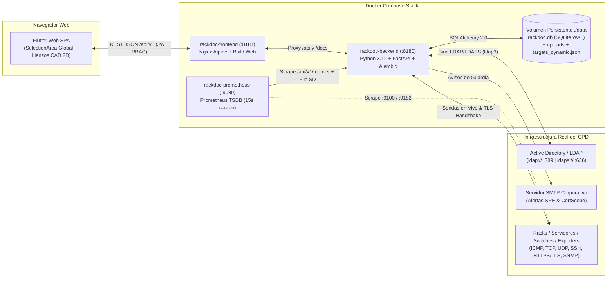

# RackDoc8 (`v1.3.1`) — Arquitectura Técnica y Diseño Modular

**RackDoc8** es una plataforma unificada de **DCIM visual**, **CMDB Multi-IP**, **Auditoría SSL/TLS (`CertScope`)**, **Monitorización Multiprotocolo (`Nagios + SNMP + Prometheus + OpenTelemetry`)** y **Gestión de Alarmas SRE**, orquestada en 3 contenedores Docker ligeros.

---

## 1. Topología de Contenedores y Flujo de Datos

---

## 2. Arquitectura del Backend (`backend/`)

El backend sigue una arquitectura limpia en **4 estratos** bajo Python 3.12 y FastAPI:

1. **Ensamblaje y Seguridad Transversal (`app/main.py`, `app/security.py`, `app/routers/_common.py`)**:
   - Cuatro routers raíz con garantías explícitas de seguridad:
     - `public_router`: `/health`, `/auth/login` e imágenes de planos/chasis.
     - `api_router`: exige token `Bearer` JWT válido y evalúa automáticamente el rol mínimo según el método HTTP y ruta (`viewer` $\le$ `operator` $\le$ `editor` $\le$ `admin`).
     - `automation_router`: autenticado mediante cabecera `X-API-Key` para playbooks Ansible y scrape de Prometheus.
     - `agent_or_session_router`: acepta indistintamente `X-API-Key` o sesión JWT.
   - Contraseñas locales protegidas con `SHA-256 + bcrypt` (evitando el truncado de 72 bytes de bcrypt puro) y autenticación corporativa real con `ldap3` (incluyendo **Auto-Provisioning JIT** y mapeo de `memberOf` a roles RBAC).

2. **Routers por Dominio (`app/routers/`)**:
   - `auth.py`: login híbrido Local/AD, gestión de usuarios, servidores LDAP/LDAPS y prueba de bind en vivo.
   - `locations.py`: jerarquía geográfica `Location -> Floor -> Room -> Aisle` y dispositivos de planta (`FloorDevice`).
   - `racks.py`: armarios 42U–48U, validación de colisiones `U`, tomas exteriores, cableado estructurado y alineación con CMDB.
   - `device_templates.py`: catálogo hardware Front/Back e importación/exportación JSON.
   - `cmdb.py`: activos Multi-IP, subredes IPAM, *Deep IP Probe*, barridos CIDR y resolución de colisiones IP.
   - `network_hosts.py`: Stacks Tecnológicos 2D, topología lógica, chequeos Nagios, conectores SNMP, grupos de guardia SRE (5 columnas) y ventanas de mantenimiento.
   - `certscope.py`: inventario y sondas TLS/STARTTLS en vivo o PEM manual de certificados X.509.
   - `automation.py`: exposición Prometheus (`/api/v1/metrics`), webhooks Ansible y manifiesto JSON para agentes IA.
   - `reports.py` y `system.py`: inventario consolidado, Excel `.xlsx` multicapa y motor Heartbeat en background.

3. **Capa de Servicios (`app/services/`)**:
   - `cmdb_service.py`: sincronización bidireccional `RackDevice / FloorDevice <-> CmdbAsset` y detección de colisiones IP.
   - `network_host_service.py`: máquina de estados Nagios (`SOFT`/`HARD`), enrutamiento SMTP de alarmas SRE, cálculo de antigüedad de alarma, generación de `targets_dynamic.json` para Prometheus e ingesta OTLP.
   - `certscope_service.py`: negociación SSL/TLS y STARTTLS, parseo X.509 y alertas de vencimiento.
   - `monitor.py`: sondas reales `ICMP`, `TCP`, `UDP`, `SSH`, `HTTP/HTTPS` y `SNMP` (codificación ASN.1/BER nativa).
   - `excel_export.py`: generación e importación de libros `.xlsx` con `openpyxl`.

4. **Persistencia y Migraciones (`app/models.py`, `app/db_migrations.py`, `alembic/`)**:
   - **31 tablas relacionales** gobernadas por **Alembic** en cada arranque (`run_migrations()`), sobre SQLite en modo `WAL` (`PRAGMA foreign_keys=ON`) o PostgreSQL vía `DATABASE_URL`.
   - Verificación estática de integridad de atributos ORM mediante `backend/tools/escaneo_atributos_orm.py` e integración continua con `pytest` en `backend/tests/`.

---

## 3. Arquitectura del Frontend (`frontend/`)

La interfaz está construida en **Flutter Web** con dos principios arquitectónicos clave:

### 3.1. Selección Global de Texto Compatible con Lienzos CAD 2D
- `RackDocShell` está envuelto en un `SelectionArea` global (`lib/main.dart`), permitiendo seleccionar y copiar cualquier texto de tablas, cabeceras, fichas técnicas, logs y diálogos.
- Todos los lienzos interactivos de arrastre 2D (Mapa, Planta Datacenter, Bastidores 42U, Stack Tecnológico 2D y tarjetas `Draggable` de catálogos y matriz de 5 columnas) están aislados con `SelectionContainer.disabled`, evitando conflictos en la arena de gestos del ratón.

### 3.2. Modularización por Dominio y Submódulos (`part` / `part of`)
Para evitar archivos monolíticos manteniendo cohesión de estado y `0` avisos en `flutter analyze`, las vistas complejas dividen su `State` en extensiones temáticas documentadas:

| Módulo UI | Punto de entrada | Submódulos (`part`) |
| :--- | :--- | :--- |
| **Shell & 5. Dashboard** | `lib/main.dart` | `features/dashboard/dashboard_overview_section.dart`, `features/shell/shell_widgets.dart` |
| **1. Locations** | `features/locations/locations_view.dart` | Vista autocontenida (OpenStreetMap + Planos) |
| **2. Datacenter** | `features/datacenter/datacenter_floor_view.dart` | `sections/datacenter_actions_and_dialogs.dart`, `sections/datacenter_canvas_2d_section.dart`, `sections/datacenter_inspector_panel.dart`, `widgets/datacenter_floor_painters.dart` |
| **3. Rack Editor** | `features/rack_editor/rack_editor_view.dart` | `sections/rack_editor_actions_and_dialogs.dart`, `sections/rack_editor_canvas_section.dart`, `sections/rack_editor_devices_and_outlets.dart`, `widgets/rack_technical_port_painter.dart` + widgets independientes (`device_catalog_panel.dart`, `properties_panel.dart`, `cable_painter.dart`) |
| **4. Red & Host** | `features/network_hosts/network_hosts_view.dart` | `tabs/tech_stack_2d_tab.dart`, `tabs/logical_topology_tab.dart`, `tabs/nagios_snmp_prometheus_tabs.dart`, `dialogs/network_hosts_crud_dialogs.dart`, `widgets/datacenter_style_host_config_panel.dart`, `widgets/network_hosts_painters.dart` |
| **6. CMDB & IPs** | `features/cmdb/cmdb_view.dart` | `tabs/cmdb_inventory_tab.dart`, `tabs/cmdb_ip_verifier_tab.dart`, `tabs/cmdb_subnets_ipam_tab.dart`, `tabs/cmdb_hypervisor_and_dialogs.dart` |
| **7. CertScope** | `features/certscope/certscope_view.dart` | Vista autocontenida de auditoría TLS/X.509 |
| **8. Alarmas SRE** | `features/sre_alarms/sre_alarms_view.dart` | `network_hosts/sre_alarms/sre_alarms_live_tab.dart`, `sre_alerts_routing_and_slo_tabs.dart`, `sre_ansible_and_ai_docs_tab.dart` |
| **9. Administración** | `features/admin/admin_view.dart` | Usuarios locales, servidores AD/LDAP y roles RBAC |
