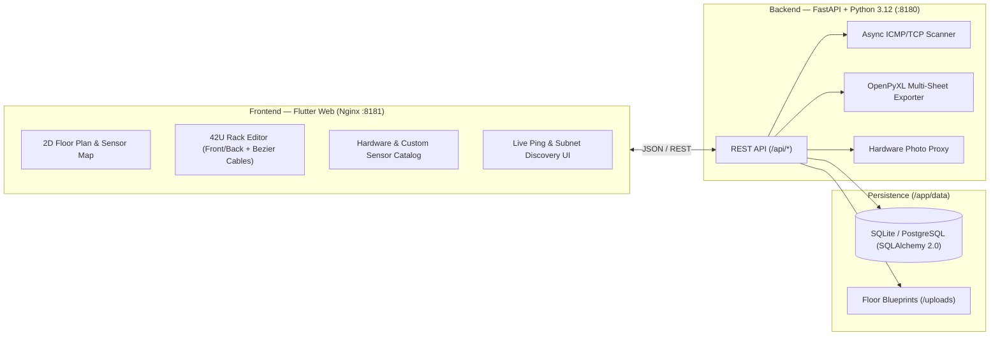

Managing physical datacenter infrastructure often falls into one of two extremes: **fragile spreadsheets and static Visio diagrams** that go out of date the moment someone moves a patch cord, or **bloated enterprise DCIM suites** that take months to configure.

To bridge that gap, I built **[RackDoc DCIM](https://github.com/mario-ezquerro/rackdoc)** — an open-source, visual **Datacenter Infrastructure Management (DCIM)** platform designed for sysadmins, network engineers, and infrastructure teams who want an interactive, CAD-like view of their datacenters, racks, structured cabling, and environmental sensors.

Even more exciting: **RackDoc DCIM was built end-to-end with [Argon](https://deepmind.google/)**, using an agentic AI pair-programming workflow to architect, iterate, containerize, and refine both the FastAPI backend and the interactive Flutter Web canvas in record time.

---

## ✨ What is RackDoc DCIM?

**RackDoc DCIM** is a containerized full-stack web application that models your entire physical and logical infrastructure from top to bottom:

`Locations (Sites) → Floors (2D Blueprints) → Rooms → Racks (42U–48U) → Hardware Chassis (Front/Back) → RJ45 / SFP+ / Power Ports → Patch Cords & Cross-Connects`

Alongside rack elevation diagrams, it includes an interactive **2D Datacenter Floor Plan** where you can drag and drop racks, telecom wall outlets (`Bi01`, `Bi02...`), IP CCTV cameras, biometric access controls, Wi-Fi 6E access points, workstations, and **environmental/electrical sensors** (Temperature, Humidity, kW/A Power Load, VESDA Smoke, Water Leak), automatically rendering the structured cabling paths back to each rack.

---

## 🤖 Built with Argon: Agentic AI Pair Programming in Action

Building a visual DCIM tool involves tricky geometric rendering, state synchronization, and relational modeling. Working with **Argon** transformed how quickly complex engineering requirements turned into production code:

1. **Rapid Full-Stack Architecture**: Argon scaffolded the complete **FastAPI + SQLAlchemy 2.0** backend alongside a **Flutter Web (Material 3 + CustomPainter)** frontend, complete with automatic schema migrations, realistic seed data, and Docker containers.
2. **Interactive Canvas & Custom Painters**: Together with Argon, we implemented custom 2D rendering engines in Flutter:
   - **Catmull-Rom / Cubic Bezier Patch Cables** in the Rack Editor that drape naturally with gravity and color-code by link type (`UTP Cat6`, `Single-Mode Fiber`, `Multi-Mode OM3/OM4`, `DAC`, `230V Power`).
   - **Cross-Connect Lateral Flags** (`RK002_M ➔`, `⬅ RK001_M`) that visually represent inter-rack patch cords without cluttering the rack elevation.
   - **Structured Cabling Floor Overlay** combining dashed orange backbone runs (Rack ↔ Telecom Outlet / Sensor) and solid blue drop cables (Telecom Outlet ↔ Workstation / VoIP / Printer).
3. **Iterative Feature Refinement from Visual Prompts**: Whenever a workflow needed refinement—such as allowing **RJ45, SFP+, and Power ports on both the Front and Back faces** of custom hardware templates, adding a **cascading Group → Category → Device picker** on empty `U` slots, or building an extensible **Custom Sensor & Device Type Creator**—Argon analyzed both backend models and UI state, verified with `flutter analyze`, rebuilt the Docker images, and deployed seamlessly.

---

## 🛠️ Key Features at a Glance

### 1. Interactive 2D Datacenter Floor Plan & Structured Cabling
- Upload custom architectural blueprints (`JPG`, `PNG`, `GIF`) for any building floor or use the built-in technical blueprint grid.
- Drag & drop **Racks** (`600×1000 mm`, `600×1200 mm`, `800×1000 mm`, `800×1200 mm`) and rotate them (`0°`, `90°`, `180°`, `270°`).
- **5 Collapsible Device & Sensor Families** in the `DEVICES LIBRARY`:
  - **Sensors & Climate / Power**: Temperature (`TMP`), Relative Humidity (`HUM`), Dual Temp+Humidity (`THM`), Electrical Load kW/A (`PWR`), Smoke/Fire (`SMK`), Water Leak (`WTR`), Airflow/Pressure (`AIR`), Door Contact (`DOR`).
  - **Security & Access Control**: IP CCTV Cameras (`CAM`), Biometric/RFID Access Control (`AC`), PIR Intrusion (`PIR`).
  - **Network, Wi-Fi & Outlets**: Wi-Fi 6E Access Points (`AP`), Wall Telecom Outlets (`Bi`).
  - **Workstations & AV**: Desktops/Workstations (`DP`), VoIP Phones (`PH`), Network Printers (`PR`), NOC Displays (`TV`).
  - **Industrial / Custom (`+ Nuevo Tipo a Medida`)**: Define your own custom device or sensor types with a custom family, ID prefix, icon, and pin color.
- **Rack Connection Selector on Drop**: Dropping any sensor or device onto the floor plan immediately lets you bind it to its target **Rack** and **Rack Port / Sensor Channel** (e.g., `ENV-MON01:Temp-1 (20.8 °C)` or `PDU-A+B:Meter-1 (5.4 kW)`), drawing the live connection line on the map.

### 2. Visual Rack Editor (Front & Back 42U Elevation)
- **Synchronized Front & Rear Views**: Inspect front network/server bezels and rear power supplies, IPMI/iDRAC ports, and 0U vertical PDUs (`PDU-A` / `PDU-B`) simultaneously.
- **Realistic Hardware Faceplates (`📷 Photo Overlay`)**: Toggle realistic SVG/image hardware faceplates for firewalls, core switches, patch panels, Dell/HPE servers, NAS enclosures, and UPS units, with an integrated backend proxy (`/api/templates/photo-proxy`) for custom equipment photos.
- **Interactive Port-to-Port Patching**: Click any port (`RJ45`, `SFP+`, `C13/C14 Power`) on the Front or Back face to trace or create patch cords—including **Cross-Rack Connections** across different racks in the room.
- **Quick `+` Slot Installer**: Click the `+` button on any empty rack unit (`U`) to launch a cascading **Group → Subcategory → Hardware Model** installer with instant `U` collision validation.

### 3. Hardware Catalog & Custom Equipment Designer
- Pre-loaded with **30+ enterprise templates** (Fortinet, Cisco Catalyst, Ubiquiti, Dell PowerEdge, HPE ProLiant, Synology, APC Smart-UPS, 0U PDUs, Patch Panels).
- **Custom Front & Back Port Distribution**: Define exact counts of `RJ45`, `SFP/SFP+`, and `Power` ports split independently between the **Front** and **Back** faces of any custom template.

### 4. Automated Network Discovery, Live Ping & Cable Audit
- **Subnet Auto-Discovery (`/24`)**: Scan management networks via concurrent ICMP + TCP probes (`22`, `80`, `443`, `161`, `8006`, `3389`) to discover live hosts and match them against mounted rack hardware.
- **Real-Time Monitoring & Threshold Alerts**: Live latency/packet-loss monitoring (`Online`, `Degraded`, `Offline`) and rack power/thermal capacity bars.
- **Multi-Tab Excel Inventory Export (`.xlsx`)**: One-click export via `openpyxl` generating formatted sheets for Racks, Mounted Devices, Port-to-Port Patching, Floor Devices/Sensors, and Power/U Utilization.

---

## 🏗️ Architecture & Tech Stack



| Layer | Technology |
| :--- | :--- |
| **AI Engineering Partner** | **Argon** (Agentic Full-Stack Architecture, UI/UX Canvas & Iterative Debugging) |
| **Frontend** | **Flutter Web (Dart 3)**, Material 3 Dark Engineering Theme, `CustomPainter` |
| **Backend** | **Python 3.12**, **FastAPI**, **SQLAlchemy 2.0**, **Pydantic v2** |
| **Database** | **SQLite** (zero-config persistent volume) or **PostgreSQL** |
| **Export & Reporting** | **OpenPyXL** (`.xlsx`), Printable Technical Elevation Sheets |
| **Deployment** | **Docker** (`rackdoc-backend` & `rackdoc-frontend` on `rackdoc-net`) |

---

## 🚀 Quick Start with Docker

You can spin up the entire platform locally in under a minute:

```bash
# 1. Clone the repository
git clone https://github.com/mario-ezquerro/rackdoc.git
cd rackdoc

# 2. Build and run the containers
docker network create rackdoc-net || true

docker build -t rackdoc-backend:latest ./backend
docker build -t rackdoc-frontend:latest ./frontend

docker run -d --name rackdoc-backend \
  --network rackdoc-net \
  -v $(pwd)/data:/app/data \
  -p 8180:8000 \
  rackdoc-backend:latest

docker run -d --name rackdoc-frontend \
  --network rackdoc-net \
  -p 8181:80 \
  rackdoc-frontend:latest
```

Then open **`http://localhost:8181`** in your browser (API docs available at **`http://localhost:8180/docs`**).

---

## 🔗 Repository & Feedback

- **GitHub Repository**: [https://github.com/mario-ezquerro/rackdoc](https://github.com/mario-ezquerro/rackdoc)

Have you tried building complex visual tools or infrastructure dashboards with **Argon**? Drop your thoughts, feature ideas, or questions in the comments below!
