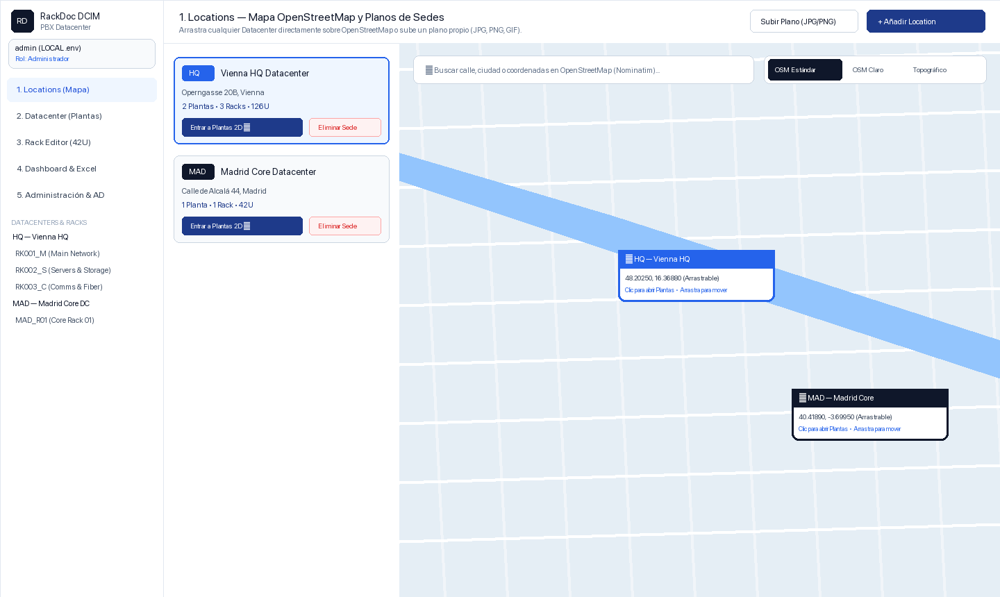
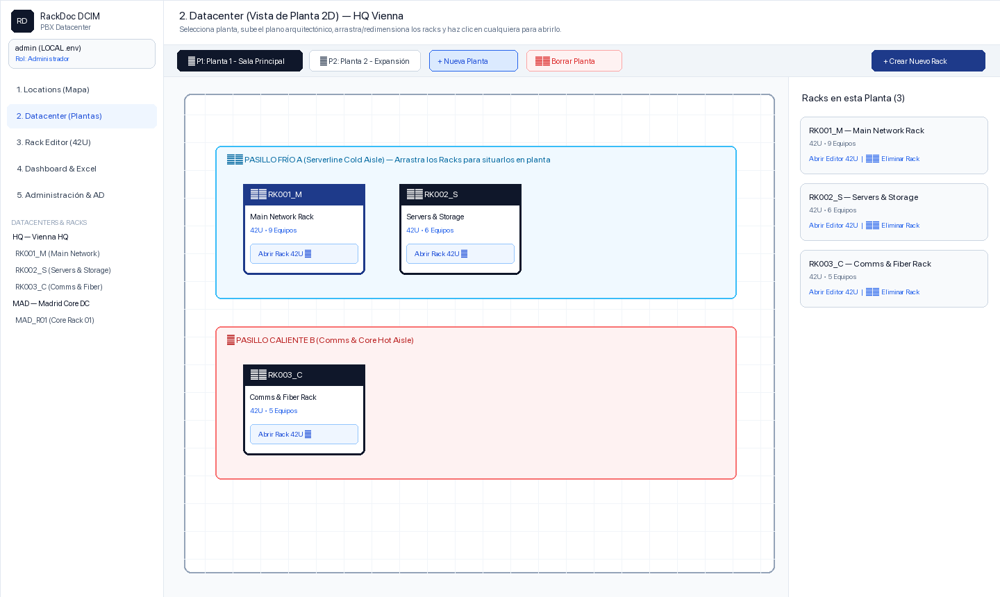
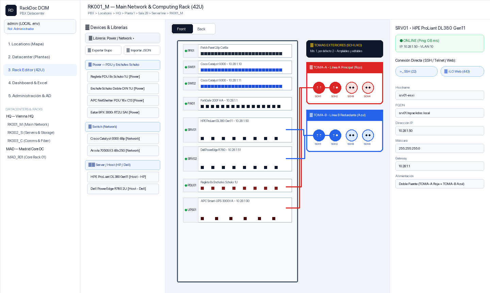
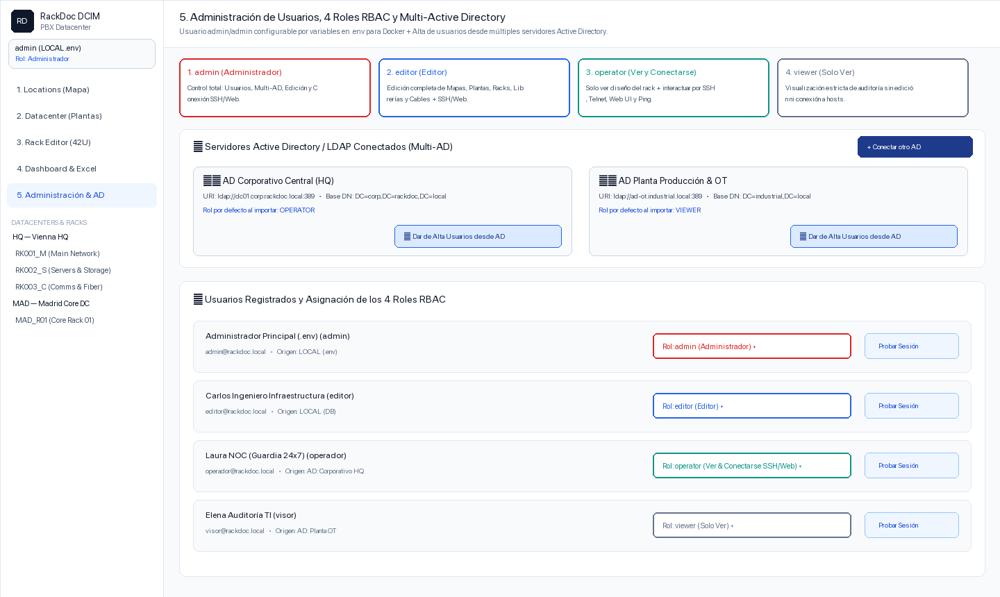

# 🗄️ RackDoc8 — Visual Datacenter & 42U Rack Infrastructure Manager (DCIM)

**RackDoc8** es una plataforma visual de gestión, monitorización y documentación de centros de datos (**DCIM**) desarrollada con **Flutter Web** (Canvas 2D interactivo estilo CAD), **FastAPI (Python)**, **SQLite** y **Docker Compose**.

Permite gestionar visualmente desde la ubicación geográfica de los Datacenters en **OpenStreetMap** o planos personalizados, pasando por las **distintas plantas 2D del edificio**, hasta el **Rack Editor 42U** con vista **Front & Back**, validación de **unidades U libres al arrastrar equipos**, librerías ampliadas (**HP ProLiant**, **Dell PowerEdge**, **Supermicro**, **Network**, **Power**), **tomas eléctricas Schuko exteriores** y **tomas exteriores de fibra óptica con número de conectores ajustable**, monitorización **Heartbeat multi-método** (ICMP, SSH, HTTPS/SSL, HTTP, TCP, SNMP), **importación y exportación Excel (`.xlsx`) con plantilla de ejemplo descargable**, y control de acceso basado en **4 roles (RBAC)** con soporte **Multi-Active Directory (LDAP/LDAPS)** por usuarios y grupos.

---

## ✨ Novedades Principales de RackDoc8

- **🗂️ Módulo Independiente `5. CMDB & Control IPs` (Multi-IP, VMs, Clusters & Verificador Manual Anti-Conflictos)**:
  - **Inventario Maestro Físico + Virtual/Lógico**: Gestiona desde un apartado propio tanto los equipos físicos sincronizados del Rack Editor y Plantas como **Máquinas Virtuales (VMs)**, **Contenedores (LXC/K8s)**, **Clusters HA / VIPs**, **Appliances Virtuales** e **Instancias Cloud/VPS** (con vínculo opcional al Servidor Físico/Hipervisor padre del Rack).
  - **Múltiples IPs por Máquina**: Separa claramente la **IP de Gestión / Manager (`mgmt_heartbeat`)** usada por el Heartbeat del resto de **IPs de Operación/Servicio** (`primary_service`, `secondary_service`, `vip_cluster`, `storage`, `backup`, `vmotion_replication`, `ilo_idrac`, `public_wan`).
  - **Verificador Manual Profundo de IPs Libres ("Deep IP Probe")**: Antes de asignar una nueva IP, comprueba bajo demanda si está verdaderamente libre en la red combinando **4 sondas reales** (*Ping ICMP + Sondeo TCP Multi-Puerto con detección de rechazo activo TCP RST + Tabla ARP/MAC L2 + DNS Inverso PTR*) y un buscador automático de próximas IPs libres por Subred/VLAN (`.1` a `.254`).
- **🎨 Identidad Visual RackDoc8**: Logo y favicon personalizado de **RackDoc8** en la pestaña del navegador (`favicon.svg` / `favicon.png`) y en toda la interfaz.
- **🔆 Tomas Exteriores de Fibra Óptica con Conectores Ajustables (`FIBRA-EXT-1`)**:
  - Además de las tomas eléctricas exteriores Schuko (`TOMA-A`, `TOMA-B`), cada rack cuenta con **Tomas Exteriores de Fibra Óptica** (`FIBRA-EXT-1`, conectores ópticos `FO1..FON` LC/SC).
  - Permite **ajustar en vivo el número de conectores de fibra (`1..48`)** tanto desde los botones rápidos `[-]` / `[+]` de la tarjeta exterior como desde el diálogo de edición (con presets `4x`, `6x`, `8x`, `12x`, `16x`, `24x FO`) y elegir el color estándar de la acometida óptica (`#0284C7` Aqua OM4, `#F59E0B` Amarillo OS2, `#10B981` Verde APC, `#7C3AED` Violeta OM5).
- **⚡ Regletas Schuko 1U con Conector Macho de Entrada (`MACHO-IN1`)**:
  - Las regletas `Power Strip 1U (8x Schuko)` incluyen8 tomas hembra (`SCH1..SCH8`) para alimentar los equipos del rack y **1 conector macho de entrada (`MACHO-IN1` — `power_schuko_male`)** para enchufar la regleta directamente a las tomas eléctricas exteriores (`TOMA-A` / `TOMA-B`).
- **📥 Importación de Datos desde Excel (`.xlsx`) con Plantilla de Ejemplo**:
  - Nuevo flujo en **Sidebar** y **4. Dashboard & Excel**: permite **descargar primero un Excel de ejemplo (`RackDoc_Plantilla_Importacion_Ejemplo.xlsx`)** con 3 hojas guiadas (`1_Racks_y_Sedes`, `2_Equipos_y_Hosts`, `3_Instrucciones_y_Librerias`) y a continuación **subir/importar un archivo `.xlsx`** para dar de alta o actualizar masivamente Sedes, Plantas, Racks y Equipos/Hosts.
- **💓 Monitorización Heartbeat en Background (4 Estados: ⚪ Gris, 🟢 Verde, 🟠 Naranja, 🔴 Rojo) + apartado independiente "Conectar" (`SSH` / `HTTP` / `HTTPS`)**:
  - Por defecto todos los equipos de Rack y de Planta tienen el Heartbeat desactivado (`⚪ Gris`). Al activarlo, permite seleccionar **uno o varios protocolos simultáneamente** (`ICMP Ping`, `TCP Port`, `HTTP`, `HTTPS`) con botón **Probar Ahora**.
  - **Semáforo de 4 colores**: `⚪ Gris` (Heartbeat desactivado), `🟢 Verde` (todos los chequeos activos responden OK), `🟠 Naranja` (al menos 1 chequeo falla y otro responde OK), `🔴 Rojo` (todos los chequeos activos fallan).
  - **Frecuencia configurable en `5. Configuración`**: Por defecto cada **5 minutos** (`300s`), ajustable en caliente desde la interfaz.
  - **Apartado independiente `Conectar`**: Permite lanzar desde el navegador conexiones directas `SSH`, `HTTP` o `HTTPS` con IP/URL y puerto independientes de la IP del Heartbeat.
- **🖥️ Modo Kiosco NOC / Videowall**:
  - Disponible en **1. Locations**, **2. Datacenter**, **3. Rack Editor** y **4. Dashboard** para pantallas de monitorización 24x7 sin distracciones, con salida mediante `ESC` o píldora flotante discreta.
- **📘 API REST Versionada (`/api/v1`) compatible al 100% con OpenAPI 3.1.0 y Swagger UI**:
  - Los **46 paths (64 operaciones HTTP)** están versionados bajo **`/api/v1/...`** (manteniendo `/api/...` como alias retrocompatible transparente) y categorizados en **10 grupos OpenAPI 3.1.0** con `summary`, `description` y esquemas Pydantic v2 en **Swagger UI (`/docs`)** y **ReDoc (`/redoc`)**.
- **🖼️ Gestión Resiliente de Planos Personalizados**:
  - Persistencia garantizada de planos subidos en el volumen Docker `/app/data/uploads` y tarjeta UX interactiva en caso de plano no disponible para subir uno nuevo o conmutar a la cuadrícula técnica CAD sin errores en pantalla.

---

## 📸 Recorrido Visual por la Plataforma

### 1. Locations — Mapa OpenStreetMap y Planos Personalizados (`JPG` / `PNG` / `GIF`)
- Visualización sobre **OpenStreetMap** sin necesidad de API Keys (*OSM Estándar*, *OSM Claro* y *Topográfico*) con buscador mundial de calles y coordenadas (**Nominatim**).
- **Arrastre directo con el ratón (Drag & Drop)** de los Datacenters sobre el mapa OpenStreetMap o sobre un plano propio subido en formato `JPG`, `PNG` o `GIF` con control de zoom/escala y redimensionado.
- Indicadores de sistemas monitorizados por sede (mostrando los contadores verde/rojo únicamente cuando son `> 0`).



---

### 2. Datacenter — Vista de Planta 2D Multi-Planta y Distribución de Racks
- Gestión de edificios con **múltiples plantas** (`Planta 1`, `Planta 2`, etc.): permite **añadir y eliminar plantas**, así como subir el plano arquitectónico de cada planta con gestión UX ante imágenes ausentes.
- Dibujo interactivo en planta 2D de los **Pasillos Frío / Caliente** y de los **Racks** con su código, numeración y estado de monitorización Heartbeat.
- Arrastra y redimensiona cada rack para colocarlo en su posición física real dentro de la sala, **elimina o añade racks**, y **haz clic sobre cualquier rack para saltar directamente a su editor 42U**.



---

### 3. Rack Editor (42U) — Arrastrar con Comprobación de U Libres, Catálogos Ampliados y Tomas Exteriores (Eléctricas & Fibra)
- **Movimiento y Arrastre Directo con Validación de Unidades `U` Libres**:
  - Arrastra cualquier equipo ya montado a otra posición del rack: el lienzo resalta en **verde** si todas las unidades `U` necesarias están libres o en **rojo** si hay colisión, además de incluir botones rápidos `▲ Subir a U libre`, `▼ Bajar a U libre`, `Mover a U...` y `Borrar Equipo`.
- **Librerías Ampliadas por Fabricante (`Devices & Librerías`)**:
  - **`Host - HP`** (12 modelos reales: *ProLiant DL20 Gen11*, *DL320 Gen11*, *DL325 Gen11*, *DL345 Gen11*, *DL360 Gen10/Gen11*, *DL365 Gen11*, *DL380 Gen10/Gen11*, *DL385 Gen11*, *DL560 Gen11*, *Alletra Storage Server 4120*).
  - **`Host - Dell`** (12 modelos reales: *PowerEdge R250*, *R350*, *R450*, *R550*, *R650*, *R650xs*, *R660*, *R6615*, *R750*, *R760*, *R760xd2*, *R7625*, *XE9680*).
  - **`Host - Supermicro`** (11 modelos reales: *SuperServer SYS-111C-NR*, *SYS-121H-TNR*, *AS-1115SV-WTNRT*, *SYS-511E-WR*, *SYS-221H-TNR*, *AS-2115HV-TNRT*, *SYS-621C-TN12R*, *SYS-211E-FRN2T*, *SuperStorage SSG-621E-ACR12H*, *GPU SYS-421GE-TNRT*, *SuperBlade SBE-820C*).
  - **`Network`**, **`Power`** y **`Patching & Passive`**.
- **Tomas Exteriores Eléctricas (`Schuko 230V`) y de Fibra Óptica (`FO1..FON LC/SC`)**:
  - Situadas fuera del bastidor a la derecha del rack: incluye por defecto **`TOMA-A`** (Roja), **`TOMA-B`** (Azul) y **`FIBRA-EXT-1`** (Caja Exterior de Fibra Óptica Aqua OM4).
  - Permite añadir nuevas tomas eléctricas (`+Schuko`) o de fibra (`+Fibra`) y **ajustar el número de conectores de fibra (`1..48`) o enchufes Schuko (`1..16`)** en cualquier momento.



---

### 4. Dashboard Monitorizado & Importación/Exportación Excel (`.xlsx`)
- **Listado Organizable y Buscable de Sistemas Monitorizados**:
  - Filtra en tiempo real por estado (`Todos`, `🟢 Verde`, `🔴 Rojo`), por método de Heartbeat (`ICMP`, `SSH`, `HTTPS`, `HTTP`, `TCP`, `SNMP`), busca por hostname/IP/modelo/rack y ordena por estado, latencia, código, IP o rack.
- **Importación y Exportación Excel (`.xlsx`)**:
  - **`Plantilla Ejemplo (.xlsx)`** (`GET /api/reports/excel/template`): Descarga una plantilla Excel de ejemplo con instrucciones y datos de muestra listos para rellenar.
  - **`Importar Excel (.xlsx)`** (`POST /api/reports/excel/import`): Carga un fichero Excel para crear o actualizar Sedes, Plantas, Racks y Equipos/Hosts automáticamente.
  - **`Exportar Inventario (.xlsx)`** (`GET /api/reports/excel`): Descarga el inventario completo multicapa del Datacenter.

---

### 5. Configuración (`⚙️`) — Login Obligatorio, Usuarios, 4 Roles RBAC y Multi-Active Directory
- **Pantalla de Login y Verificación de Contraseña al Cambiar de Usuario**:
  - Acceso inicial protegido por usuario y contraseña, y solicitud de contraseña al cambiar de sesión de usuario.
- **Icono de Rueda de Configuración (`⚙️`)**:
  - Permite dar de alta usuarios locales con contraseña, asignar cualquiera de los **4 roles RBAC** (`admin`, `editor`, `operator`, `viewer`), registrar múltiples servidores **Active Directory (LDAP/LDAPS)** y aplicar roles tanto a **Usuarios AD** como a **Grupos de Active Directory (`ADRoleMapping`)**.



---

## 🚀 Despliegue Rápido con Docker Compose

### 1. Configurar el fichero `.env`
```bash
cp .env.example .env
```

Variables principales en `.env`:
```env
ADMIN_USERNAME=admin
ADMIN_PASSWORD=admin
ADMIN_EMAIL=admin@rackdoc.local
RACKDOC_DB_PATH=/app/data/rackdoc.db
```

### 2. Levantar los contenedores
```bash
docker compose up -d --build
```

- **Aplicación Web (Frontend Flutter + Nginx)**: [http://localhost:8181](http://localhost:8181)
- **Swagger UI Interactivo (`/api/v1`)**: [http://localhost:8180/docs](http://localhost:8180/docs) (o [http://localhost:8181/docs](http://localhost:8181/docs))
- **Documentación ReDoc**: [http://localhost:8180/redoc](http://localhost:8180/redoc)
- **Esquema OpenAPI 3.1.0 JSON**: [http://localhost:8180/openapi.json](http://localhost:8180/openapi.json)
- **Credenciales por defecto**: Usuario `admin` / Contraseña `admin`

---

## 📘 Especificación OpenAPI 3.1.0 y Endpoints `/api/v1`

El backend cumple íntegramente con la especificación oficial **[OpenAPI 3.1.0 (OAS)](https://github.com/OAI/OpenAPI-Specification)**. Todos los endpoints del cliente Flutter Web consumen el prefijo versionado **`/api/v1`** (manteniendo `/api` como alias retrocompatible):

| Categoría OpenAPI (`tag`) | Prefijo / Rutas principales (`/api/v1/...`) | Descripción |
| :--- | :--- | :--- |
| **Monitoring & Heartbeat** | `GET/PUT /api/v1/monitoring/settings`, `POST /api/v1/monitoring/run-now`, `POST /api/v1/devices/{id}/ping`, `POST /api/v1/floor-devices/{id}/ping` | Motor Heartbeat en background (cada 5 min por defecto) y comprobación multiprotocolo bajo demanda (`⚪ Gris`, `🟢 Verde`, `🟠 Naranja`, `🔴 Rojo`). |
| **Locations & Topology** | `GET/POST/PUT/DELETE /api/v1/locations`, `POST/PUT/DELETE /api/v1/floors` | Jerarquía geográfica de Sedes (Datacenters) y Plantas. |
| **Datacenter Rooms & Aisles** | `POST/PUT/DELETE /api/v1/rooms`, `POST/PUT/DELETE /api/v1/aisles` | Salas técnicas, pasillos fríos/calientes y posicionamiento 2D de racks. |
| **Floor Devices & Environmental Sensors** | `GET/POST/PUT/DELETE /api/v1/rooms/{id}/floor-devices`, `POST /api/v1/floor-devices/{id}/remote-console` | Equipos de planta (cámaras IP, APs Wi-Fi, impresoras, SAI/UPS, sensores IoT y rosetas). |
| **Racks & Rack Devices** | `GET/PUT/DELETE /api/v1/racks/{id}`, `POST /api/v1/racks/{id}/devices`, `PUT/DELETE /api/v1/devices/{id}` | Inventario 42U Front/Back, validación de colisiones U, bandejas multi-equipo y acometidas exteriores. |
| **Cabling & Connections** | `POST/PUT/DELETE /api/v1/connections`, `GET /api/v1/racks/{id}/inter-rack-targets` | Trazabilidad punto a punto de latiguillos UTP, fibra óptica OM4/OS2 y cables eléctricos intra-rack e inter-rack. |
| **Device Templates & Library** | `GET/POST/PUT/DELETE /api/v1/templates`, `GET /api/v1/templates/export`, `POST /api/v1/templates/import` | Catálogo de plantillas hardware y fotos de chasis desde Wikimedia Commons. |
| **Dashboard, KPIs & Excel Reports** | `GET /api/v1/reports/dashboard-inventory`, `GET /api/v1/reports/excel`, `POST /api/v1/reports/excel/import` | KPIs ejecutivos de capacidad U, estados Heartbeat y auditoría Excel (`.xlsx`). |
| **Authentication, RBAC & Active Directory** | `POST /api/v1/auth/login`, `GET/POST/PUT/DELETE /api/v1/users`, `GET/POST/PUT/DELETE /api/v1/ad-servers` | Autenticación local y Multi-Active Directory (LDAP/LDAPS) con 4 roles RBAC. |
| **Static Assets & Uploads** | `POST/DELETE /api/v1/upload-plan`, `GET /api/v1/uploads/{filename}` | Subida y entrega de planos arquitectónicos personalizados. |

---

## 🏗️ Arquitectura del Proyecto

```text
rackdoc/
├── .env.example                  # Variables de entorno (ADMIN_USERNAME=admin, ADMIN_PASSWORD=admin)
├── docker-compose.yml            # Orquestación Docker (Backend FastAPI :8180 + Frontend Nginx :8181)
├── docs/screenshots/             # Capturas de pantalla de la documentación
├── backend/                      # API REST en Python 3.12 + FastAPI + SQLAlchemy + OpenPyXL
│   └── app/
│       ├── main.py               # Endpoints REST (Locations, Floors, Racks, Libraries, Outlets Power/Fiber, RBAC, Multi-AD, Excel Import/Export)
│       ├── database.py           # Persistencia SQLite y directorio /app/data/uploads en volumen Docker
│       ├── models.py             # Modelos SQLAlchemy (Location, Floor, Room, Rack, DeviceTemplate, RackDevice, Port, Connection, User, ADServer, ADRoleMapping)
│       ├── schemas.py            # Esquemas Pydantic v2
│       ├── seed.py               # Semilla automática (.env admin, HP/Dell/Supermicro, Regletas Schuko Macho, Tomas Eléctricas y de Fibra)
│       └── services/
│           └── excel_export.py   # Exportación, Plantilla de Ejemplo e Importación masiva en Excel (.xlsx)
└── frontend/                     # Aplicación interactiva en Flutter Web (RackDoc8)
    ├── web/                      # Favicon SVG/PNG y Manifiesto Web con el logo oficial de RackDoc8
    └── lib/
        ├── main.dart             # Shell de navegación, Login Gate, Dashboard Monitorizado e Importador Excel (.xlsx)
        ├── core/api_client.dart  # Cliente HTTP REST hacia FastAPI y Nominatim OpenStreetMap
        ├── models/               # Modelos de datos tipados en Dart
        └── features/
            ├── locations/        # 1. Mapa OpenStreetMap arrastrable + subida resiliente de planos JPG/PNG/GIF
            ├── datacenter/       # 2. Editor de Plantas 2D del edificio y posicionamiento de Racks
            ├── rack_editor/      # 3. Rack Editor 42U (Front/Back, Drag & Drop U libres, Tomas Eléctricas y de Fibra Exteriores)
            └── admin/            # 5. Configuración (⚙️) de Usuarios, Contraseñas, 4 Roles RBAC y Grupos/Usuarios Active Directory
```
