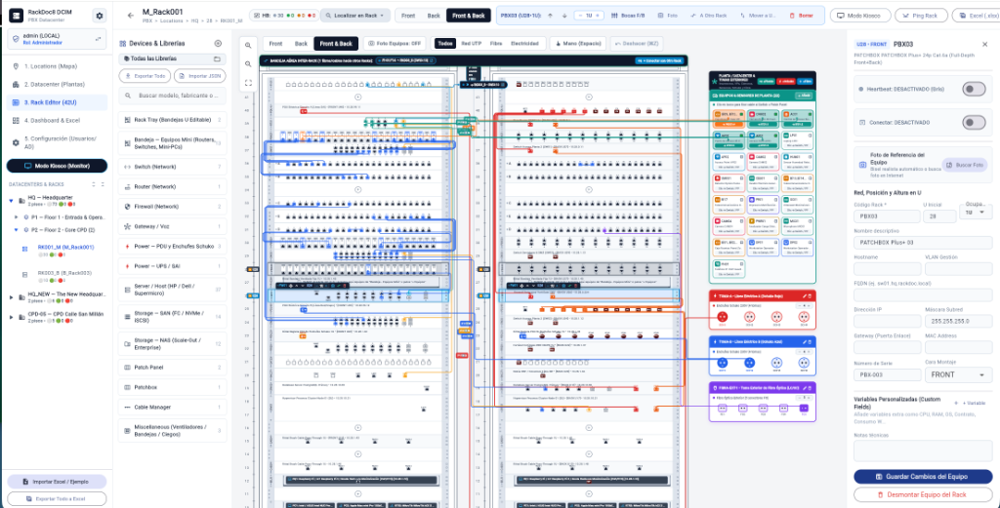
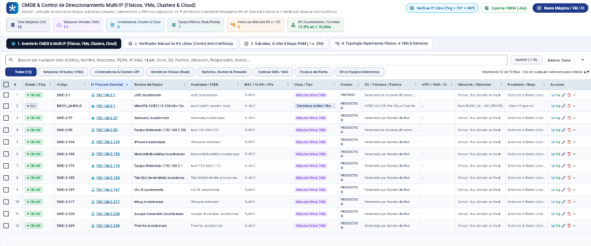

# 🗄️ RackDoc8 — Visual Datacenter, 42U Rack Editor, CMDB Multi-IP & Network Telemetry (DCIM)

**RackDoc8** es una plataforma integral de gestión visual de centros de datos (**DCIM**), **CMDB Multi-IP con control anti-colisiones**, **Topología Lógica / Stack Tecnológico 2D** y **Telemetría Real (Heartbeat + Nagios + SNMP + Prometheus + OpenTelemetry)** desarrollada con **Flutter Web** (Canvas 2D interactivo estilo CAD), **FastAPI (Python 3.12)**, **SQLite**, **Prometheus TSDB** y **Docker Compose**.

Diseñada para operar sobre **infraestructura real (modo POC / Producción limpio, sin datos simulados ni falsos positivos)**, coordina en tiempo real la ubicación física de los equipos (Sedes $\rightarrow$ Plantas 2D $\rightarrow$ Racks 42U Front/Back) con la **CMDB de direcciones IP, VLANs y Subredes**, los **Stacks Tecnológicos de negocio** y el sistema de **monitorización y alertas con Active Directory**.

---

## 🧭 Los 8 Módulos Principales de RackDoc8

La barra lateral izquierda estructura el flujo completo de extremo a extremo en **8 módulos**:

### 1. 📍 `1. Locations (Mapa)` — Mapa Geográfico OpenStreetMap y Planos Personalizados
- Visualización interactiva sobre **OpenStreetMap** sin necesidad de API Keys (*OSM Estándar*, *OSM Claro* y *Topográfico*) con buscador mundial de direcciones y coordenadas (**Nominatim**).
- **Arrastre directo con el ratón (Drag & Drop)** de las Sedes / Datacenters sobre el mapa o sobre planos propios (`JPG`, `PNG`, `GIF`) con control de zoom y escala.
- Resumen en vivo de plantas, salas, racks y estado Heartbeat (`⚪ Sin monitorizar`, `🟢 Online`, `🟠 Warning`, `🔴 Offline`) por cada sede.


---

### 2. 🏢 `2. Datacenter (Plantas)` — Editor 2D Multi-Planta, Pasillos y Equipos de Planta
- Gestión de edificios con **múltiples plantas** (`Planta 1`, `Planta 2`, etc.) y subida resiliente de planos arquitectónicos en `/app/data/uploads`.
- Posicionamiento y redimensionado 2D de **Pasillos Frío / Caliente**, **Racks** y **Equipos de Planta (`FloorDevice`)** (Cámaras IP, Puntos de Acceso Wi-Fi, Impresoras, SAI/UPS, Sensores IoT y Rosetas de pared).
- **Sincronización automática con CMDB**: cualquier equipo de planta con dirección IP se sincroniza automáticamente con la CMDB y su sede correspondiente.


---

### 3. 🗄️ `3. Rack Editor (42U)` — Bastidor CAD Front & Back, Cableado y Alineación con CMDB
- **Vista Dual Simultánea (`Front + Back`) o Individual**:
  - Validación automática de **unidades `U` libres consecutivas** al arrastrar equipos con el ratón, historial de deshacer (`Ctrl+Z` / `⌘Z`) y modo mano con barra espaciadora.
  - **Bandejas de Rack 19" (`BDJ`)**: permite alojar hasta 4 mini-equipos (*Routers MikroTik/UniFi, ONTs, Mini-Switches, Mini-PCs/NUCs*) sobre una misma bandeja 1U.
- **Librerías Hardware por Fabricante (`Devices & Librerías`)**:
  - **`Host - HP`** (*ProLiant DL20/DL320/DL325/DL345/DL360/DL365/DL380/DL385/DL560 Gen10/Gen11*, *Alletra 4120*).
  - **`Host - Dell`** (*PowerEdge R250/R350/R450/R550/R650/R660/R750/R760/XE9680*).
  - **`Host - Supermicro`** (*SuperServer*, *SuperStorage*, *GPU Server*, *SuperBlade*).
  - **`Storage - SAN / NAS`**, **`Network`**, **`Power`**, **`Patching & Passive` (`PATCHBOX` / Patch Panels 24p y 48p)** y **`Bandeja - Equipos Mini`**.
- **Tomas Exteriores Eléctricas (`Schuko 230V`) y de Fibra Óptica (`FIBRA-EXT-1` con conectores `FO1..FON` ajustables)** situadas a la derecha del bastidor.
- **Detección Proactiva de Colisiones de IP con la CMDB**:
  - Al montar un equipo en el Rack o editar su IP en el panel derecho, RackDoc8 verifica en tiempo real si esa IP ya existe en la CMDB (por ejemplo, si fue descubierta previamente con el escáner de red).
  - Si detecta coincidencia, muestra un asistente interactivo permitiendo **unificar ambos registros en un único activo** (conservando la posición `U` del Rack y fusionando estado Online, latencia, MAC, FQDN e IPs secundarias) o **reasignar la IP** sin duplicar dispositivos.




---

### 4. 🕸️ `4. Red & Host` — Stack Tecnológico 2D, Topología Lógica, Nagios, SNMP, Prometheus y Alertas AD
Organizado en **7 pestañas operativas**:
1. **`1. Stack Tecnológico (Lógica de Negocio)`**:
   - Lienzo 2D estilo CAD para diseñar múltiples esquemas de servicio (ej. *Portal Ecommerce, ERP, Clúster K8s*).
   - Permite dibujar **cajas/zonas delimitadoras** con título y metadatos, arrastrar **nodos vinculados a activos reales de la CMDB**, trazar **flechas de flujo de negocio desde los 4 conectores laterales** de cada nodo, abrir una **ventana flotante con gráficas Prometheus en vivo** y lanzar sesión **SSH** directa.
2. **`2. Topología Lógica & Capas`**:
   - Mapa automático por capas (`Core/Firewall`, `Switches`, `Hipervisores`, `VMs/Contenedores`, `BBDD/Middleware`) y gestión de enlaces lógicos (`LLDP Trunk`, `Hypervisor -> VM`, `Reverse Proxy -> App -> DB`).
3. **`3. Hosts, Servicios & Estados (Nagios)`**:
   - Chequeos reales de servicios por activo (`ICMP`, `TCP`, `HTTP/HTTPS`, `SSH`, `DNS`, `SNMP`, `PostgreSQL`, `MySQL`, `Redis`, `Docker`, `Proxmox`) con máquina de estados estilo **Nagios Core (`OK`, `WARNING`, `CRITICAL`, `UNKNOWN` en modo `SOFT`/`HARD`)** y control de días restantes de **certificados SSL/TLS**.
4. **`4. Switches & Bocas SNMP / LLDP`**:
   - Inspección boca a boca (`ifIndex`, `ifName`, estado `UP/DOWN`, VLAN, velocidad, caudal `In/Out Mbps`, vecinos `LLDP/CDP`) y sincronización con los puertos físicos del Rack Editor.
5. **`5. Telemetría Prometheus & Agentes (OpenTelemetry / Exporters)`**:
   - Integración directa con el contenedor **`rackdoc-prometheus` (`:9090`)** que recolecta `/api/v1/metrics` cada 15 segundos y añade dinámicamente targets de agentes externos (`node_exporter :9100`, `windows_exporter :9182`, `cadvisor :8080`, `snmp_exporter :9116`).
   - Receptor HTTP nativo **OpenTelemetry (`POST /api/v1/otel/v1/metrics`)** para ingesta push de métricas reales de CPU, RAM y Disco.
   - Asistente guiado con fragmentos `docker-compose.yml` y comandos listos para copiar e instalar agentes en servidores Linux/Windows.
6. **`6. Avisos, Alarmas & Matriz Active Directory`**:
   - Matriz visual de **4 columnas con Drag & Drop**: *1. Grupos de Hosts* $\rightarrow$ *2. Reglas de Enrutamiento* $\rightarrow$ *3. Grupos de Usuarios (Active Directory / Locales)* $\rightarrow$ *4. Contactos*, además de ventanas de mantenimiento programadas y configuración SMTP/Webhook.
7. **`7. Manifiesto IA & Contexto Operativo (JSON)`**:
   - Exportación estructurada en JSON de toda la topología física, lógica y de red para auditoría o integración con agentes LLM.

---

### 5. 📊 `5. Dashboard & Excel` — Auditoría Hierro Línea a Línea, Patch Panels Boca a Boca y Excel
- **3 Vistas de Auditoría Técnica**:
  - **Hierro Línea a Línea**: listado de cada equipo montado en cada Rack con su rango `U`, modelo, serie, IP y estado.
  - **Patch Panels Boca a Boca (`1..24` / `1..48`)**: detalle de qué boca está libre u ocupada y hacia qué puerto de switch/equipo conecta.
  - **Sistemas Monitorizados (Heartbeat)**: buscador y filtros por estado (`🟢 Online`, `🟠 Warning`, `🔴 Offline`) y protocolo.
- **Importación y Exportación Excel (`.xlsx`)**:
  - Descarga de **Plantilla Excel de Ejemplo** (`GET /api/v1/reports/excel/template`), **Importación masiva** (`POST /api/v1/reports/excel/import`) y **Exportación completa multicapa** (`GET /api/v1/reports/excel`).

---

### 6. 🗂️ `6. CMDB & Control IPs` — Inventario Estilo Excel, Multi-IP, Locations y Anti-Colisiones
Dividido en **4 sub-apartados**:

#### 6.1. `1. Inventario CMDB & Multi-IP` (Tabla Estilo Excel)
- **Tabla estilo hoja de cálculo Excel** con búsqueda global instantánea por cualquier campo, filtros rápidos (Clase CI, **Sede / Location**, **Máscara de Red**, Estado) y **ordenación ascendente/descendente en todas las columnas**:
  - `Código CI`, `Nombre / Hostname / FQDN`, `Clase CI`, **`Sede / Location`** (coordinada con `1. Locations`), **`Posición en Rack`**, **`Posición en Stack`**, `IP Principal (Heartbeat)`, **`Máscara de Red`** (`255.255.255.0`), `IPs Secundarias / VIPs`, `VLAN` y `Estado Heartbeat`.
- **Enlaces Directos Interactivos**:
  - **Enlace a la posición del Rack**: si el equipo está en un Rack (o es una VM alojada en un servidor de Rack), muestra un chip azul interactivo (ej. `Rack RK001_M • U30`) que al pulsarlo te lleva directamente a **`3. Rack Editor`** seleccionando y resaltando el dispositivo.
  - **Enlace a la posición del Stack Tecnológico**: si el activo forma parte de un Stack Tecnológico, muestra un chip morado interactivo (ej. `Stack: Portal ERP • DB01`) que al pulsarlo abre **`4. Red & Host -> Stack Tecnológico`** centrando ese diagrama y nodo.
- **Control de Heartbeat en Vivo y Edición Multi-IP**:
  - Permite **activar o desactivar el Heartbeat** con un clic directamente desde la fila del inventario o desde el editor del activo/IP, diferenciando el rol de cada IP (`mgmt_heartbeat`, `primary_service`, `vip_cluster`, `storage`, `backup`, `ilo_idrac`, etc.) y su **Máscara de Red**.
- **Banner y Asistente de Resolución de Colisiones de IP (`Rack Editor <-> CMDB`)**:
  - Si dos activos comparten la misma IP (por ejemplo, un router detectado en un escaneo CMDB como `DISC-2-1` y dado de alta también en el Rack Editor como `RK001_M-ROU5`), aparece un **Banner Rojo de Colisión de IP** y un botón **«Resolver Colisión»** en las filas afectadas para **unificarlos en un solo equipo**, **cambiar/liberar la IP** o **eliminar el duplicado**.



#### 6.2. `2. Verificador Manual de IPs Libres` ("Deep IP Probe" & Escáner de Red)
- **Comprobación Individual de IP** y **Escáner de Rango Completo CIDR (`/24`, `/23`, `/25`, etc.)**:
  - Combina 4 sondas reales (*Ping ICMP + TCP Multi-Puerto con filtrado de falsos positivos Proxy-ARP/RST + Tabla ARP/MAC L2 + DNS Inverso PTR*).
  - **Coordinación con `Locations`**: permite asociar el rango escaneado a una **Sede / Location** concreta (o dejarlo global) y ajustar la máscara de red antes de importar equipos a la CMDB.
  - **Alta individual o masiva (`+ Añadir a CMDB`)**: incorpora únicamente los equipos con respuesta real verificada en red y actualiza al instante su etiqueta a **`En CMDB`** en color verde.

#### 6.3. `3. Subredes, VLANs & Mapa de Red (.1 a .254)`
- Cada rango o subred puede vincularse opcionalmente a una **Sede / Location (`1. Locations`)**.
- **Matriz visual interactiva `.1` a `.254`**: al pulsar sobre cualquier casilla ocupada se abre la **Ficha Completa del Dispositivo** con sus datos de CMDB/Rack, botón para saltar a su fila en el Inventario y botón para **Liberar / Desocupar la IP** cuando un equipo se retira.

#### 6.4. `4. Árbol Servidor Físico -> VMs`
- Vista jerárquica de qué Máquinas Virtuales, Contenedores LXC/K8s o Servicios corren sobre cada Servidor Físico montado en el Rack.

---

### 7. 🔐 `7. CertScope (SSL/TLS)` — Auditoría, Verificación Automática y Alertas de Caducidad de Certificados
Ubicado justo debajo de `6. CMDB & Control IPs`, proporciona un inventario centralizado estilo hoja de cálculo Excel para el ciclo de vida de **todos los certificados X.509 (HTTPS / TLS / PKI interna / Offline)** de la infraestructura:
- **Doble Modo de Alta y Verificación**:
  - **Modo Automático (`https_live`)**: conecta en vivo por TLS/SSL a `host:puerto` (`443`, `8443`, `8006`, `9443`, etc.), soportando tanto certificados públicos como autofirmados o de CA interna (`OpenSSL x509`), y extrae automáticamente `Common Name (CN)`, `Emisor (CA)`, `SANs`, `Serial`, `Huella SHA-256`, `Versión TLS`, `Fecha de Caducidad` y `Días Restantes`.
  - **Modo Manual / Offline (`manual`)**: para certificados que no pueden sondearse por red (VPN IPsec, firmas, redes aisladas), permitiendo indicar manualmente la fecha de vencimiento o pegar el bloque `-----BEGIN CERTIFICATE-----` para extraer sus metadatos al instante.
- **Integración Directa al Dar de Alta Dispositivos**:
  - Desde **`3. Rack Editor`**, **`2. Datacenter (Plantas)`**, **`6. CMDB`** o vía **API (`cURL` / `Ansible` / `Puppet`)**, cualquier equipo puede marcarse con **`Comprobar caducidad de Certificado HTTPS en CertScope`** para registrarlo y verificarlo automáticamente al guardar.
- **Enlaces Directos Interactivos y Avisos a Personas / Grupos**:
  - Cada fila de CertScope incluye chips clicables que te llevan directamente a la posición del equipo en el **Rack (`U`)**, en el **Plano de Planta (`2. Datacenter`)**, en la **CMDB (`6. CMDB`)** o en el **Stack Tecnológico (`4. Red & Host`)**.
  - Permite asignar **Grupos de Contacto / Personas** y correos para enviar avisos automáticos o bajo demanda cuando un certificado manual está próximo a caducar (`<=30 días`) o en estado crítico (`<=7 días`).

---

### 8. ⚙️ `8. Administración & Avisos (Usuarios / AD)` — Login, 4 Roles RBAC y Multi-Active Directory
- Acceso protegido por pantalla de Login y verificación de contraseña al cambiar de usuario activo.
- Gestión de usuarios locales, **4 roles RBAC** (`admin`, `editor`, `operator`, `viewer`), múltiples servidores **Active Directory (LDAP/LDAPS)** con mapeo de permisos para usuarios y grupos (`ADRoleMapping`), y ajuste en caliente del intervalo del motor Heartbeat.


---

## 🤖 Guía de Alta Automática vía API (`cURL`, `Ansible` y `Puppet`)

RackDoc incluye una guía completa y un asistente interactivo en la propia interfaz web (**botón «Alta vía API (cURL / Ansible / Puppet)»** en `6. CMDB` y `7. CertScope`) con ejemplos funcionales listos para copiar que muestran cómo dar de alta un dispositivo con toda la información posible (Hardware, Multi-IP, Ubicación en Rack/Planta, Prometheus y Certificado SSL en CertScope):

👉 **[Ver Guía Completa de Alta vía API REST (`cURL`, `Ansible` y `Puppet`) — `docs/API_ONBOARDING_CURL_ANSIBLE_PUPPET.md`](docs/API_ONBOARDING_CURL_ANSIBLE_PUPPET.md)**

---

## 🚀 Despliegue Rápido con Docker Compose

### 1. Configurar el fichero `.env`
```bash
cp .env.example .env
```

Variables principales en `.env`:
```env
ADMIN_USERNAME=admin
ADMIN_PASSWORD=admin
ADMIN_EMAIL=admin@rackdoc.local
BACKEND_PORT=8180
FRONTEND_PORT=8181
PROMETHEUS_PORT=9090
PING_INTERVAL_SECONDS=60
```

### 2. Levantar los 3 contenedores (`frontend`, `backend` y `prometheus`)
```bash
docker compose up -d --build
```

| Servicio / Contenedor | URL Local | Descripción |
| :--- | :--- | :--- |
| **`rackdoc-frontend`** | [http://localhost:8181](http://localhost:8181) | Interfaz gráfica interactiva **RackDoc8** (Flutter Web + Nginx). |
| **`rackdoc-backend`** | [http://localhost:8180/docs](http://localhost:8180/docs) | API REST **FastAPI (`/api/v1`)**, Swagger UI, ReDoc (`/redoc`) y receptor OTLP. |
| **`rackdoc-prometheus`** | [http://localhost:9090](http://localhost:9090) | Servidor **Prometheus TSDB** integrado con scrape automático cada 15s. |

- **Credenciales iniciales por defecto**: Usuario `admin` / Contraseña `admin`

---

## 📘 Especificación OpenAPI 3.1.0 y Endpoints `/api/v1`

Todos los endpoints del backend cumplen con **OpenAPI 3.1.0** bajo el prefijo versionado **`/api/v1`** (manteniendo `/api` como alias retrocompatible):

| Categoría OpenAPI (`tag`) | Rutas Principales (`/api/v1/...`) | Descripción |
| :--- | :--- | :--- |
| **Monitoring & Heartbeat** | `GET/PUT /api/v1/monitoring/settings`, `POST /api/v1/monitoring/run-now`, `POST /api/v1/devices/{id}/ping`, `POST /api/v1/floor-devices/{id}/ping` | Motor Heartbeat real en background y sondas bajo demanda (`ICMP`, `SSH`, `HTTP/HTTPS`, `TCP`, `UDP`, `SNMP`). |
| **Locations & Topology** | `GET/POST/PUT/DELETE /api/v1/locations`, `POST/PUT/DELETE /api/v1/floors` | Sedes geográficas (Datacenters) y Plantas 2D. |
| **Datacenter Rooms & Aisles** | `POST/PUT/DELETE /api/v1/rooms`, `POST/PUT/DELETE /api/v1/aisles` | Salas técnicas, pasillos frío/caliente y distribución 2D de racks. |
| **Floor Devices & Sensors** | `GET/POST/PUT/DELETE /api/v1/floors/{id}/floor-devices` | Equipos de planta (Cámaras IP, Wi-Fi APs, SAI/UPS, sensores) sincronizados con CMDB. |
| **Racks & Rack Devices** | `GET/PUT/DELETE /api/v1/racks/{id}`, `POST /api/v1/racks/{id}/devices`, `PUT/DELETE /api/v1/devices/{id}` | Rack Editor 42U Front/Back, validación de `U` libres, bandejas y alineación automática con CMDB. |
| **Cabling & Connections** | `POST/PUT/DELETE /api/v1/connections`, `GET /api/v1/racks/{id}/inter-rack-targets` | Trazabilidad punto a punto de cables UTP, fibra óptica OM4/OS2 y alimentación eléctrica. |
| **Device Templates & Library** | `GET/POST/PUT/DELETE /api/v1/templates`, `GET /api/v1/templates/export`, `POST /api/v1/templates/import` | Catálogo hardware personalizable e importación/exportación JSON. |
| **CMDB, Multi-IP & IP Verification** | `GET /api/v1/cmdb/overview`, `POST/PUT/DELETE /api/v1/cmdb/assets`, `POST /api/v1/cmdb/verify-ip`, `POST /api/v1/cmdb/scan-range`, `POST /api/v1/cmdb/import-discovered`, `GET /api/v1/cmdb/check-ip-owner`, `POST /api/v1/cmdb/resolve-ip-collision`, `POST/DELETE /api/v1/cmdb/subnets` | Inventario CMDB estilo Excel, múltiples IPs por máquina, coordinación con Locations, Deep IP Probe y resolución de colisiones de IP con el Rack Editor. |
| **Red & Host (Topología, Nagios, SNMP, Prometheus & OTel)** | `GET /api/v1/network-hosts/overview`, `GET /api/v1/metrics`, `POST /api/v1/otel/v1/metrics`, `POST/PUT/DELETE /api/v1/network-hosts/tech-stacks`, `POST /api/v1/network-hosts/service-checks/{id}/run` | Stacks Tecnológicos 2D, estados Nagios, bocas SNMP/LLDP, exposición Prometheus, ingesta OpenTelemetry y matriz de alertas Active Directory. |
| **Dashboard, KPIs & Excel Reports** | `GET /api/v1/reports/dashboard-inventory`, `GET /api/v1/reports/excel`, `GET /api/v1/reports/excel/template`, `POST /api/v1/reports/excel/import` | Auditoría de hierro línea a línea, patch panels boca a boca e importación/exportación Excel (`.xlsx`). |
| **Authentication, RBAC & Active Directory** | `POST /api/v1/auth/login`, `GET/POST/PUT/DELETE /api/v1/users`, `GET/POST/PUT/DELETE /api/v1/ad-servers`, `POST /api/v1/ad-role-mappings` | Control de acceso con 4 roles RBAC y autenticación híbrida Local + Multi-Active Directory. |

---

## 🏗️ Estructura del Proyecto

```text
rackdoc/
├── .env.example                        # Variables de entorno por defecto
├── docker-compose.yml                  # Orquestación de 3 contenedores (backend :8180, frontend :8181, prometheus :9090)
├── docs/screenshots/                   # Capturas de pantalla de la documentación
├── backend/                            # API REST en Python 3.12 + FastAPI + SQLAlchemy + OpenPyXL
│   └── app/
│       ├── main.py                     # Endpoints REST versionados (/api/v1) y worker Heartbeat en background
│       ├── database.py                 # Persistencia SQLite, migraciones automáticas en caliente y volumen /app/data
│       ├── models.py                   # Modelos SQLAlchemy (Locations, Racks, CMDB Multi-IP, TechStacks, Nagios, SNMP, AD)
│       ├── schemas.py                  # Esquemas de validación Pydantic v2
│       ├── seed.py                     # Inicialización limpia de catálogos hardware y usuario administrador (.env)
│       └── services/
│           ├── cmdb_service.py         # Sincronización bidireccional Rack<->CMDB, colisiones IP, Deep IP Probe y Subredes
│           ├── network_hosts_service.py# Stacks Tecnológicos 2D, Nagios, SNMP, Prometheus TSDB y receptor OpenTelemetry
│           ├── monitor.py              # Sondas reales multiprotocolo (ICMP, TCP, HTTP/HTTPS, SSH, UDP, SNMP)
│           ├── excel_export.py         # Exportación multicapa, Plantilla de Ejemplo e Importación Excel (.xlsx)
│           └── wikimedia_Commons.py    # Obtención de imágenes reales de equipamiento hardware
└── frontend/                           # Aplicación interactiva en Flutter Web (RackDoc8)
    ├── web/                            # Favicon SVG/PNG y Manifiesto Web
    └── lib/
        ├── main.dart                   # Shell principal con los 7 módulos, Login Gate, Kiosk Mode y Dashboard
        ├── core/api_client.dart        # Cliente HTTP REST hacia /api/v1 y Nominatim OpenStreetMap
        ├── models/                     # Modelos de datos tipados en Dart
        └── features/
            ├── locations/              # 1. Mapa OpenStreetMap arrastrable y planos personalizados
            ├── datacenter/             # 2. Editor 2D de Plantas, Pasillos, Racks y Equipos de Planta
            ├── rack_editor/            # 3. Rack Editor 42U Front/Back, Bandejas y prevención de colisiones IP
            ├── network_hosts/          # 4. Red & Host (Stacks 2D, Topología, Nagios, SNMP, Prometheus/OTel, Alertas AD)
            ├── cmdb/                   # 6. CMDB & Control IPs (Tabla Excel, Multi-IP, Locations, Escáner y Colisiones IP)
            └── admin/                  # 7. Configuración (Usuarios, 4 Roles RBAC y Multi-Active Directory)
```
