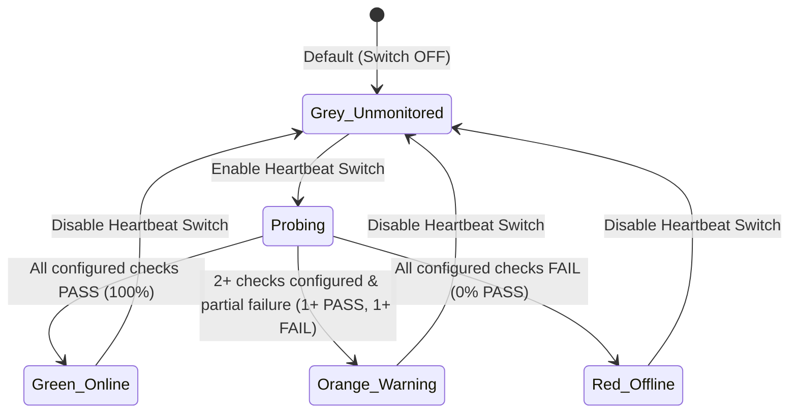

> *For DEV.to Markdown copy-paste, the screenshot above is also hosted at:*
> `https://raw.githubusercontent.com/mario-ezquerro/rackdoc/main/docs/rackdoc_v1_1_screenshot.png`

Since launching **[RackDoc DCIM](https://github.com/mario-ezquerro/rackdoc)**—our open-source visual Datacenter, Rack & Sensor Management platform built with **FastAPI** and **Flutter Web**—real-world usage in complex server rooms pushed us to rethink several core workflows.

In **RackDoc DCIM v1.1**, we focused on **operational clarity, high-density hardware ergonomics, and NOC wallboard readiness**. Here is a complete tour of everything new in this release and how we engineered it.

---

## 1. 🫀 Background Multi-Protocol Heartbeat Engine & 4-Color Status Model

In a real datacenter, not every piece of mounted equipment has an IP stack (think passive patch panels, brush cable managers, or basic PDUs), and many critical appliances expose multiple health surfaces at once (e.g., an ICMP management IP, an SSH daemon, an HTTPS API, and an SNMP agent).

In **v1.1**, we redesigned monitoring around four core principles:

1. **Disabled by Default & Clean Collapsed UI**:
   - Every rack device and floor sensor starts with Heartbeat **OFF**.
   - When disabled, the right-hand properties panel shows **only the toggle switch** (`Heartbeat: DESACTIVADO (Gris)`), keeping the UI clean and uncluttered.
   - Turning the switch **ON** expands the multi-protocol selector (`ICMP Ping`, `SSH`, `HTTP / HTTPS`, `TCP`, `UDP`, `SNMP`), per-protocol target/port/status configuration cards, and an on-demand **“Probar ahora” (Test Now)** button.
2. **Always Executed in the Background (Backend Worker)**:
   - Health checks never block or depend on the browser tab. An asynchronous background loop in FastAPI (`_background_heartbeat_loop`) periodically probes all enabled rack devices and floor sensors, while the Flutter frontend polls lightweight status summaries.
3. **Configurable Check Frequency**:
   - From **`5. Configuración`**, administrators can adjust the global Heartbeat interval on the fly (**5 minutes by default**, with 1-click presets for `1`, `2`, `5`, `10`, `15`, `30`, `60 min` or custom minutes) or trigger a global check across the entire datacenter.
4. **4-Color Status Semantics (⚪ Grey / 🟢 Green / 🟠 Orange / 🔴 Red)**:
   - **⚪ Grey (`unmonitored`)**: Equipment with Heartbeat disabled. Counted explicitly in every Location, Floor, Rack, and Dashboard badge so you always know how many elements are passive/unmonitored vs. actively watched.
   - **🟢 Green (`online`)**: Heartbeat enabled and **all** configured protocol checks succeed.
   - **🟠 Orange (`warning` — Partial Failure)**: Heartbeat enabled with **2 or more checks** configured where **at least one fails and at least one succeeds** (for example, `ICMP Ping` responds, but the `HTTPS :8443` web console or `SNMP :161` agent is down).
   - **🔴 Red (`offline`)**: Heartbeat enabled and **all** configured checks fail.



---

## 2. 🔗 Decoupled Frontend “Conectar” Panel (SSH / HTTP / HTTPS)

A common pitfall in DCIM tools is assuming that the **monitoring target** is identical to the **management connection endpoint**. In practice, you might ping a switch on its VLAN IP (`10.20.0.2`), but connect to its web UI via an internal reverse proxy URL (`https://sw-core01.noc.corp:8443`) or jump host SSH port.

RackDoc v1.1 separates **Heartbeat** (Backend) from **Conectar** (Frontend):

- Every rack device and floor device/sensor has an independent **`Conectar`** card right below `Heartbeat`.
- When **OFF** (default), it collapses to a single toggle row (`Conectar: DESACTIVADO`).
- When **ON**, you can enable **SSH**, **HTTP**, and/or **HTTPS**, each with **its own independent Host/IP, Port, Username, or URL**.
- Clicking **`Conectar por SSH`**, **`Conectar por HTTP`**, or **`Conectar por HTTPS`** executes directly in the **Frontend browser/OS** (`ssh://user@host:port` + automatic clipboard copy of `ssh -p <port> user@host`, or opening the target Web UI in a new browser tab).

---

## 3. 🔌 High-Density 48-Port Switch CAD Geometry & Hover Ergonomics

As shown in the screenshot above (`M_Rack001`), modeling high-density 1U/2U switches (such as **48× RJ45 + 4× SFP+ Catalyst / FortiSwitch** chassis) and **PATCHBOX Plus+ 24p** cassettes required sub-pixel precision so that port numbers and patch cords remain legible even when dozens of cables cross the rack:

- **24+24 Dual-Row Matrix + Right-Hand SFP+ Uplink Block**: 48-port switches automatically arrange odd ports (`1, 3, ... 47`) on the upper row and even ports (`2, 4, ... 48`) on the lower row, with dedicated uplink spacing on the right (`49..52 SFP+`), preventing port labels from colliding with horizontal chassis dividers.
- **Non-Occluding Floating Action Toolbar**: Hovering or selecting a mounted device now places the quick-action pill (`Mover U`, `Bandeja`, `Borrar`) **above the top edge of the chassis** (`top: -22px`) instead of overlapping ports `1..23`.
- **Interactive Hover Shading (`▶ Uxx`)**: Moving the cursor over any rack unit highlights the entire chassis in a crisp technical blue tint (`#DBEAFE`) with a `▶ Uxx` indicator on the left rail, making it unmistakable which device you are about to inspect or patch.

---

## 4. 🧰 Rack Trays (`Bandejas U`), Inter-Rack Overhead Trays & Floor Patching

Real racks don't just hold standard 19" rackmount servers:

- **Editable Rack Trays (`Bandejas U`)**: Mount a 1U/2U shelf and place multiple **mini-appliances** side by side on the same tray—such as **Raspberry Pi**, **Intel NUC**, **Apple Mac mini**, **MikroTik Mini-Routers**, **ISP Fiber ONTs**, or **IP KVMs**—each with its own IP, ports, and patch cords.
- **Overhead Inter-Rack Cable Tray (`Bandeja Aérea Inter-Rack`)**: Route UTP, Fiber, or DAC trunks cleanly between different racks in the room (`RK001_M ↔ RK003_B`) through the top overhead raceway.
- **External Floor & Power Terminations (`PLANTA-DC`, `TOMA-A`, `TOMA-B`, `FIBRA-EXT`)**: Link structured cabling from the 2D Datacenter Floor Plan (temperature/humidity sensors, CCTV cameras, biometric readers, wall outlets) and room Schuko/IEC power feeds directly into rack patch panels and PDUs.

---

## 5. 📺 NOC Kiosk Mode (`Modo Kiosco`) for Wallboards & Videowalls

Need to display your global datacenter map, 2D floor plan, 42U rack elevation, or live Heartbeat dashboard on a NOC TV monitor?

- **1-Click Kiosk Mode**: Available from the left sidebar and top toolbars across **`1. Locations`**, **`2. Datacenter`**, **`3. Rack Editor`**, and **`4. Dashboard`**.
- **Zero-Clutter Fullscreen Canvas**: Automatically hides sidebars, library drawers, and editing chrome, starting a silent auto-refresh loop.
- **Discreet Translucent Exit & View Switcher**: A tiny, nearly transparent pill (`opacity: 0.22`) rests in the bottom-right corner so it never distracts on a wall monitor. Hovering over it illuminates quick-jump chips (`1. Mapa`, `2. Planta`, `3. Rack`, `4. Dashboard`) and the **`Salir Kiosco (ESC)`** button.

---

## 6. 🔐 4-Tier RBAC + Multi-Active Directory & 100× Faster Startup

- **4 Role-Based Access Control Tiers**:
  - `admin`: Full control over users, Active Directory servers, settings, and hardware.
  - `editor`: Create/edit locations, floors, racks, cables, and sensors + launch remote connections.
  - `operator`: Read-only on physical rack geometry, **with permission to test Heartbeats and launch SSH/HTTP/HTTPS connections**.
  - `viewer`: Strict read-only auditing mode.
- **Multi-Active Directory (LDAP / LDAPS) + Local Users**: Connect multiple AD domains with automatic `Group DN → Role` mapping alongside local database accounts.
- **Sub-Second Startup Optimization**: By deferring heavy base64 floorplan blobs on the initial `/api/locations` tree query (`defer(UploadAsset.data_url)`) and enabling FastAPI `GZipMiddleware`, initial load time dropped from puluhan megabytes to **~4.5 KB in <15 ms**.

---

## 🐳 Run RackDoc DCIM v1.1 in 30 Seconds from Docker Hub

Pre-built multi-arch images are published directly on Docker Hub under [`cloudresources/rackdoc-backend`](https://hub.docker.com/r/cloudresources/rackdoc-backend) and [`cloudresources/rackdoc-frontend`](https://hub.docker.com/r/cloudresources/rackdoc-frontend):

```bash
# 1. Create the Docker network
docker network create rackdoc-net || true

# 2. Launch the FastAPI Backend (with persistent SQLite + settings volume)
docker run -d --name rackdoc-backend \
  --network rackdoc-net \
  --restart unless-stopped \
  -p 8180:8000 \
  -v $(pwd)/data:/app/data \
  cloudresources/rackdoc-backend:1.1.0

# 3. Launch the Flutter Web Frontend
docker run -d --name rackdoc-frontend \
  --network rackdoc-net \
  --restart unless-stopped \
  -p 8181:80 \
  cloudresources/rackdoc-frontend:1.1.0
```

Then open **`http://localhost:8181`** (default credentials: `admin` / `admin`) and explore the interactive 42U Rack Editor, 2D Floor Plan, and Background Heartbeat engine!

---

## 🔗 Links & Resources

- **GitHub Repository**: [https://github.com/mario-ezquerro/rackdoc](https://github.com/mario-ezquerro/rackdoc)
- **Docker Hub Organization**: [https://hub.docker.com/orgs/cloudresources/repositories](https://hub.docker.com/orgs/cloudresources/repositories)

What protocols or hardware templates would you like to see next in RackDoc DCIM? Let me know in the comments!
